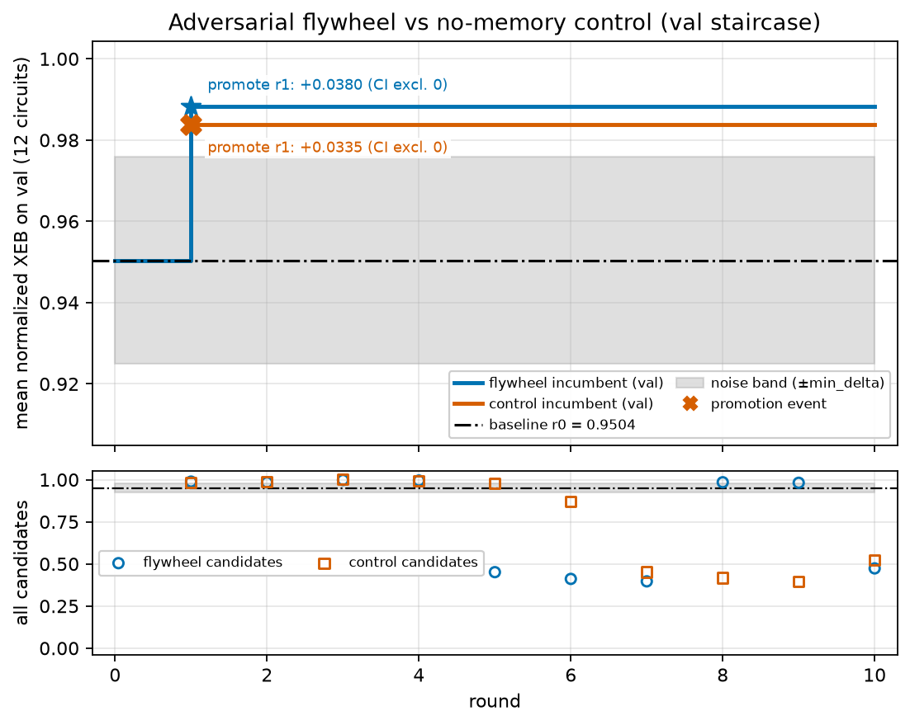
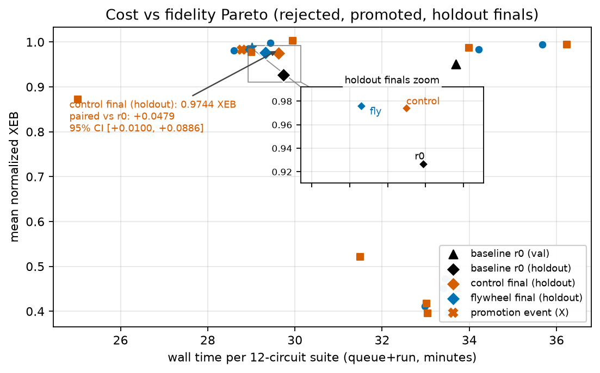

# adversarial-replication-flywheel

A preregistered, ledger-enforced optimization loop that turns classical
simulation of quantum circuits into an adversarial search — built for the
BlueQubit Quantum Flywheel RFP (Track 2: *AI for breaking quantum-advantage
claims via adversarial classical simulation*).

**The claim we test**: an attacker with a fixed budget can *learn* how to
allocate classical simulation resources (MPS bond dimension, qubit-site
order, shot allocation) across a family of circuits, and beat both a fixed
baseline and an equal-budget no-memory search. Every accept/reject decision
is made by an immutable experiment ledger on a preregistered validation
split; the holdout stayed sealed and was evaluated exactly once, at campaign
close — researcher degrees of freedom are preregistered away.

## The loop

```
freeze suite (48 exact-truth RCS circuits, 24/12/12 train/val/HOLDOUT)
        │
        ▼
   G3 baseline ──► incumbent (uniform χ=64, 20k shots)
        │                + noise calibration → min_delta
        ▼
   ┌──────────────── flywheel round ────────────────┐
   │ ONE mutation (χ_alloc | permutation | shots)   │
   │ evaluate on val (decision) + train (feedback)  │
   │ paired bootstrap CI vs incumbent               │
   │ PROMOTE only if ledger gates pass:             │
   │   Δ > min_delta AND CI excludes 0              │
   │   AND cost noninferior within 2%               │
   └────────────────────────────────────────────────┘
        │                    │
   flywheel arm         no-memory control arm
  (insights feed        (fixed ladder, equal budget,
   the next proposal)    no memory of results)
        │                    │
        ▼                    ▼
   ONE-SHOT locked holdout evaluation (sentinel; campaign closes)
        │
        ▼
   report + claims.json (every performance number → cloud job ID;
   exact reference probabilities are frozen local statevector files)
```

## Results — RUN OF RECORD (personal account, closed 2026-10-12)



**Headline**: the canonical campaign re-ran end-to-end on the personal
account with **zero code changes** (replication mode: identical seeds,
stripped-manifest content-sha gate). Over 10 preregistered rounds per arm,
**each arm promoted exactly one candidate** — the same round-1 χ-allocation
(`easy32hard128`; flywheel Δ +0.03800, CI [+0.0024, +0.0800]; control
Δ +0.0335) — and both gains **survived the locked, one-shot holdout**:

| config (holdout, 12 circuits) | XEB | paired Δ vs r0 | 95% CI | cost (holdout wall min) |
|---|---|---|---|---|
| baseline r0 (uniform χ64, 20k shots) | 0.92652 | — | — | 29.7 min |
| control final (easy32hard128) | 0.97441 | +0.0479 | [+0.0100, +0.0886] | 29.6 min |
| **flywheel final (easy32hard128)** | **0.97611** | **+0.0496** | [+0.0137, +0.0889] | **29.3 min** |

- **Flywheel vs control on the holdout: +0.0017, 95% CI [−0.0058,
  +0.0098]** — includes zero. At this scale the adaptive memory matched a
  tuned no-memory control and did not beat it; we report parity, not a
  win.
- **Frozen prediction HIT**: point 0.975191, band [0.950381, 0.999],
  actual 0.976113 (in band). The prediction was frozen at G3, before any
  mutation round, and scored exactly once at campaign close.
- **Ledger totals**: 865 jobs, all on `mps.cpu`, $0.00 spend. All numbers
  resolve to job IDs in `runs/report/jobs_export.{json,csv}` and the
  machine-checked claims ledger (31 claims / 432 refs / 336 distinct).
- **Disclosed incident**: the 36 holdout-scoring jobs were routed to the
  TEST account by an orchestrator environment omission (the campaign's
  829 jobs all ran on the personal account; the ledger records device
  and cost, not account, and `mps.cpu` results are account-independent).
  The run was left to finish — the one-shot holdout sentinel was already
  unlocked — and the omission is disclosed here and in the appendix
  instead of being patched in silence.
- **Replication deltas vs the original TEST run** (same suite sha, same
  seeds, baseline identical at 0.950381 on val): TEST showed 0/10 flywheel
  promotions and a missed prediction; this run promoted 1/1 per arm and
  hit the band — the r1 flywheel CI shifted just past zero. Both runs are
  reported; neither is cherry-picked.

## Results — original TEST-account campaign (closed 2026-10-07; kept as history)

*The staircase image and `runs/report/` artifacts in this repo now hold
the run-of-record (personal) regeneration above; the numbers below are
the original TEST-account campaign as closed on 2026-10-07.*

**Headline**: over 10 preregistered rounds per arm, the flywheel earned
**0/10 promotions** — an honest plateau, not a bug: its best candidate
(r3, χ-alloc easy32hard256, Δ +0.0419) cleared the mean-delta bar but its
95% CI [−0.0056, +0.1005] included zero, so the ledger gate refused it.
The equal-budget **no-memory control promoted 1/10** (r1, χ-alloc
easy32hard128) and that promotion **survived the locked holdout**:

| config (holdout, 12 circuits) | XEB | paired Δ vs r0 | 95% CI | cost (holdout wall min) |
|---|---|---|---|---|
| baseline r0 (uniform χ64, 20k shots) | 0.9340 | — | — | 30.1 min |
| control final (easy32hard128) | **0.9847** | **+0.0507** | [+0.0133, +0.0897] | **29.8 min** |
| flywheel final (= r0, never promoted) | 0.9275 | −0.0065 | [−0.0149, +0.0016] | 30.1 min |

Three honest negatives, each a deliverable in the grant sense:

1. **Memory did not pay at this scale.** The insight stream (χ-easy/hard
   split discovered in round 1) is exactly what the control's fixed ladder
   found on its own; with 12-circuit val noise (sd 0.0135), the flywheel's
   extra information never converted into a promotable edge.
2. **Our frozen prediction MISSED.** Point 0.9766, band [0.9532, 0.999];
   actual flywheel holdout 0.9275, in-band = False — a val→holdout
   generalization gap of ~0.026 that concentrates on the deeper circuits,
   exactly where χ64 truncation binds. Predictions are scored, not buried.
3. **Permutations are χ-dependent layout damage, not free symmetry.**
   Depth-monotone collapse (d8 XEB 0.5–0.7 → d16 0.05–0.28 at χ ≤ 64).
   Permutation wall-time premiums were 0.3–2.8% at uniform χ64 (flywheel
   rounds) and 10.8–18.7% under the control's mixed χ32/χ128 incumbent;
   uniform-χ128 permutation trials were not recorded. The truncation
   fingerprint is a real adversarial signature, published as a finding.

Cost-fidelity view of everything that was tried:



Total spend: **$0.00** — 905 ledgered jobs on CPU-class devices
(878 `mps.cpu`, 12 `cpu`, 15 `pauli-path` probes), including the 36 holdout
jobs; every performance number traces to a cloud job ID in
`runs/report/claims.json`, exact reference probabilities are frozen local
statevector files, and two derived quantities (threshold formula, frozen
prediction) cite their formulas and the frozen prediction record.
Full report: `runs/report/report.md`.

## Known limitations

- Splits are not depth-stratified: the holdout carries 4 depth-4 circuits,
  the val split none (and one 26-qubit depth-4); the ~0.026 val→holdout
  generalization gap partly reflects this composition difference, not noise
  alone.
- The cost gate is a point-ratio screen on noisy wall-times: two identical
  baseline runs differed 35.36 vs 33.43 min on val.
- Shot presets assumed a 6-easy/6-hard circuit mix; the frozen manifest is
  7 easy / 5 hard (220k/208k actual vs 240k nominal shots).
- All 20 round decisions used pointwise 95% CIs with no multiplicity
  control.
- Campaign-exact semantics were verified on `mps.cpu` only.
- Three control prereg files were rewritten post-hoc for timestamp-only
  recovery (documented in the campaign log); hashes reconstructed and
  re-pinned at record time.

## What we measure

Per-circuit **normalized linear XEB** on `mps.cpu` against exact local
statevector probabilities (20–26 qubits, RCS brickwork, depths 4–16):
1 = exact, 0 = uniform noise. Cost = queue+run wall minutes of the val jobs.
Zero promotions is a valid, preregistered outcome.

## Platform findings (BlueQubit, 2026-10-06, TEST account)

1. **`mps.cpu` count keys are bit-reversed** relative to the `cpu` device /
   qiskit display order. Scoring mps counts without canonicalizing collapses
   normalized XEB to ≈ 0 even for a near-exact sampler (measured −0.03 raw
   vs +1.02 canonicalized on the same job; evidence:
   `runs/20261006T025115Z_g1/metrics.json`, rescore amendment).
   Fixed in `metrics.canonical_counts`.
2. **`pauli-path` is degenerate on random RCS observables**: truncation
   ε ≤ 1e-5 is rejected server-side (memory overflow); ε ≥ 1e-4 runs but
   returns expectation value **exactly 0.0** (empty retained path set) —
   demonstrated against local exact ground truth at 20q (280 s of genuine
   compute, EV 0.0 vs exact −0.001112; evidence:
   `runs/20261006T030424Z_g15b/metrics.json`, EXP-002B probe3 verdict).
   Cited from the preregistered screen; do not re-litigate with budget.
3. **The peaked-circuits endpoint** (`/api/v1/peaked-circuits/file`) returns
   403 on the TEST account at every difficulty — the sponsor-supplied Lane P
   was parked (ledger cause: EXTERNAL_ENDPOINT_DENIED) and the design pivoted
   to exact-truth RCS (documented in `experiments/EXP-002*/`).

## Reproduce

```bash
cp .env.example ../.env   # BLUEQUBIT_API_KEY_ACCOUNT_TEST=...
./reproduce.sh            # $0 on cpu-class devices; ~1 day wall clock
```

Everything lands in `runs/` with one `metrics.json` per experiment, the job
ledger in `ledger/jobs.sqlite`, and the final report + claims ledger in
`runs/report/`. See `OCT11-RUNBOOK.md` for the personal-account rerun.

## Invariants (enforced in code, not by convention)

- **Ledger first**: no cloud job outside a REGISTERED experiment; `record`
  sha-pins SPEC + PREREGISTRATION; `promote` re-hashes everything (3-attempt
  cap; park/ban require an explicit cause class).
- **Holdout locked at freeze** (chmod 000 + access log); evaluated exactly
  once by `src/holdout_eval.py`, which writes the campaign-closing sentinel.
- **One mutation per round**, decided only on the 12 val circuits; train rows
  are selection feedback and never part of a gate.
- **L-004**: a healthy recorded run is never re-run; terminal experiments
  refuse further attempts.
- Every performance number in the report maps to a cloud job ID in
  `claims.json`; exact reference probabilities are frozen local statevector
  files, and two derived quantities (threshold formula, frozen prediction)
  cite their formulas and the frozen prediction record.
