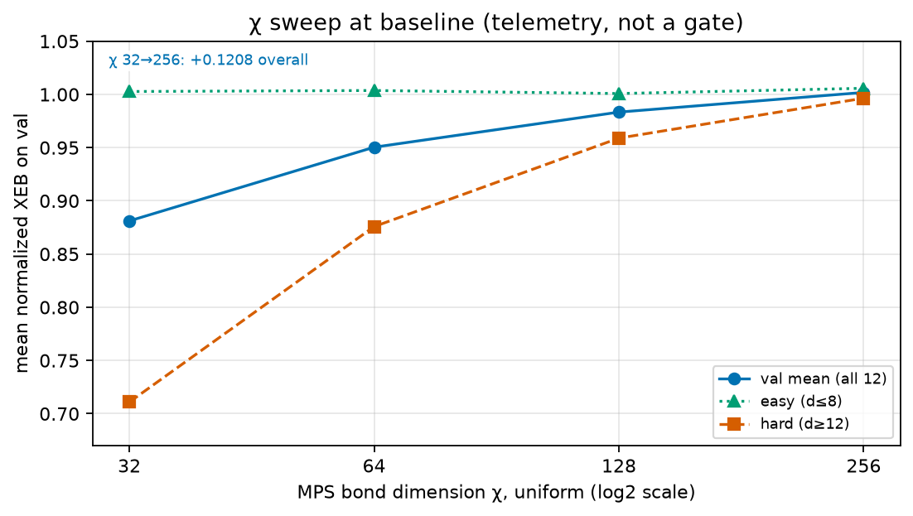

# Adversarial Replication Flywheel — campaign report (personal account)

Generated 2026-10-13T05:36:03+00:00 · suite sha256 `2e583cf82eaf70e9…` ·
10 flywheel rounds + 10 control rounds ·
1/10 flywheel promotions, 1/10 control
promotions.
Frozen prediction (made at G3, before any round): point 0.97519, band [0.95038, 0.99900] — actual 0.97611, in band: **True**.

Score: mean per-circuit normalized XEB (1 = exact). Device: mps.cpu ($0).
Promotion gate: paired 95% CI excludes 0 AND mean delta > min_delta
(0.02544 = 2x measured run-to-run sd) AND cost noninferior
within 2% — enforced by the experiment ledger, never by hand.

## Headline

The flywheel completed 10 preregistered rounds with 1 promotions; the no-memory control promoted 1. The control-arm promotion was confirmed on the locked holdout (paired delta vs r0 below).

## Holdout (G6, evaluated ONCE, 12 circuits)

| config | mean normalized XEB | paired delta vs r0 | 95% CI |
|---|---|---|---|
| baseline r0 | 0.92652 | — | — |
| no-memory control final | 0.97441 | +0.04789 | [+0.01002, +0.08863] |
| flywheel final | 0.97611 | +0.04959 | [+0.01375, +0.08890] |

Flywheel minus control (paired): +0.00170, CI
[-0.00580, +0.00979].

## Val staircase (per round)

| arm | round | mutation | value | mean delta | 95% CI | cost ratio | verdict |
|---|---|---|---|---|---|---|---|
| flywheel | 1 | chi_alloc | easy32hard128 | +0.03800 | [+0.00243, +0.07996] | 0.861 | PROMOTED |
| control | 1 | chi_alloc | easy32hard128 | +0.03352 | [+0.00116, +0.06997] | 0.854 | PROMOTED |
| flywheel | 2 | chi_alloc | uniform128 | -0.00456 | [-0.01458, +0.00639] | 1.179 | rejected |
| control | 2 | chi_alloc | uniform128 | +0.00312 | [-0.00844, +0.01384] | 1.181 | rejected |
| flywheel | 3 | chi_alloc | easy32hard256 | +0.00994 | [-0.00281, +0.02321] | 1.015 | rejected |
| control | 3 | chi_alloc | easy32hard256 | +0.01911 | [+0.00413, +0.03419] | 1.041 | rejected |
| flywheel | 4 | chi_alloc | uniform256 | +0.00633 | [-0.00579, +0.01954] | 1.230 | rejected |
| control | 4 | chi_alloc | uniform256 | +0.01074 | [-0.00343, +0.02542] | 1.259 | rejected |
| flywheel | 5 | permutation | 11 | -0.53729 | [-0.68423, -0.35685] | 1.151 | rejected |
| control | 5 | chi_alloc | easy16hard128 | -0.00610 | [-0.02105, +0.00814] | 1.008 | rejected |
| flywheel | 6 | permutation | 23 | -0.57739 | [-0.69914, -0.44737] | 1.137 | rejected |
| control | 6 | chi_alloc | uniform32 | -0.11167 | [-0.20534, -0.02947] | 0.869 | rejected |
| flywheel | 7 | permutation | 37 | -0.59192 | [-0.69883, -0.47639] | 1.155 | rejected |
| control | 7 | permutation | 11 | -0.53231 | [-0.67533, -0.35297] | 1.171 | rejected |
| flywheel | 8 | shots_alloc | easy10khard30k | -0.00368 | [-0.01880, +0.01179] | 0.997 | rejected |
| control | 8 | permutation | 23 | -0.56659 | [-0.68559, -0.43889] | 1.147 | rejected |
| flywheel | 9 | shots_alloc | easy4khard36k | -0.00681 | [-0.01748, +0.00374] | 0.986 | rejected |
| control | 9 | permutation | 37 | -0.58823 | [-0.69197, -0.47538] | 1.148 | rejected |
| flywheel | 10 | permutation | 211 | -0.51502 | [-0.65080, -0.36211] | 1.153 | rejected |
| control | 10 | permutation | 51 | -0.46232 | [-0.61072, -0.30383] | 1.094 | rejected |

## Cost-fidelity Pareto

## chi telemetry sweep (G3)

## Zero-promotion clause

Promotions above are the complete set; every other round was rejected by the gate.

Full per-round metrics: runs/flywheel/*/, every job in ledger/jobs.sqlite
(export below). Claims ledger: claims.json.
